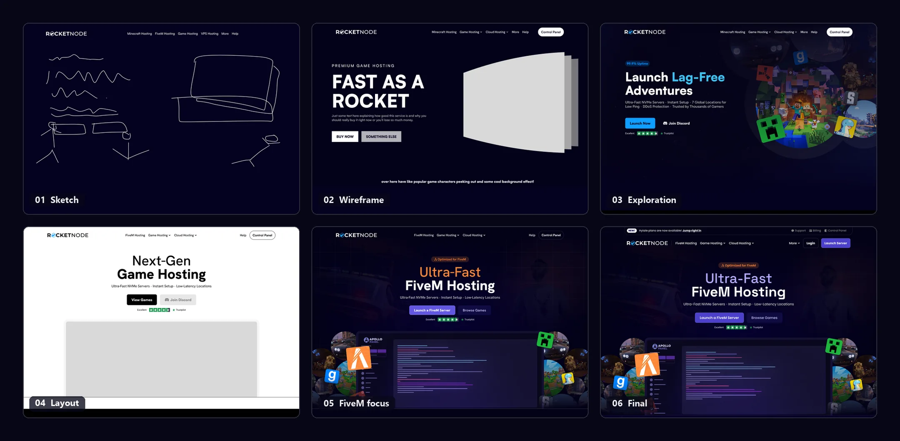

## Overview

RocketNode hosts game servers, with FiveM (the multiplayer platform for GTA V) as its main product, alongside Minecraft, Rust and a long list of other games, plus VPS, web, Discord bot and dedicated server hosting.

I designed the whole marketing site, from the first sketches of the homepage hero to every product, support and company page, on desktop and mobile.

## The brief

The brief was a page-by-page list: a homepage, a game browser, a page for each game, VPS, website, Discord bot and dedicated server hosting, plus locations, DDoS protection, hardware, partners, support, affiliates, about and legal. Fifteen page types in total.

A few requests shaped the whole project:

- **A hero with its own character.** Something in the spirit of competitors like Iceline, but with a creative, unique touch, and specifically not a carousel.
- **Plans as individual cards, not a slider.** Customers should see every option at once.
- **A step system for configuring a server.** Pick a hardware tier, a location, a billing cycle and extras such as storage or priority support.
- **The same system for VPS, with a different feel.** Familiar steps, but its own look.

## Process

The hero went through the most rounds. It started as a rough sketch and a "Fast as a Rocket" wireframe with a placeholder for game characters peeking out from the side. From there I explored a left-aligned version with a cluster of game worlds, then stripped it back to a centred grayscale layout to get the structure right before adding colour.

The breakthrough was putting the product itself at the centre. The final hero shows RocketNode's game panel surrounded by the games it runs, which explains what the company does at a glance. Late on, the copy shifted from generic "Next-Gen Game Hosting" to leading with FiveM, the company's main product, and the accent moved from orange to the purple used across the site.

## Navigation

With dozens of games and five hosting products, the navigation had to do a lot without feeling heavy. The games menu leads with recognisable game icons, so people can jump straight to what they play, with small badges for new games and deals. A second column covers the game services. Account links (support, billing and the control panel) live in a slim bar above, out of the way of the main menu.

## Picking a plan

Game pages use a numbered configurator instead of a pricing slider. Every hardware tier is visible as its own card, and each location shows an estimated ping, so customers can pick the closest server without guessing. An order summary sits beside the steps and keeps a running total, so the price never comes as a surprise at checkout.

## Same system, different feel

VPS customers choose from fewer, bigger options, so the same idea takes a different shape. A four-step progress bar (tier, location, billing, plan) walks through one decision at a time, and a summary row along the bottom fills in as each choice is made.

## Shared building blocks

Fifteen page types only stay consistent if they share parts. I built the site from one set of sections reused across every page: features, data centre locations, the game panel, DDoS protection, FAQs, reviews, blog posts and a closing call to action. Each page adds the content specific to it, such as plans, hardware or partner tiers, and the shared sections do the rest.

The location grid is a good example. Ping estimates are colour-coded from green to red, so the closest locations stand out without anyone needing to read the numbers.

## Mobile

Every shared section has a mobile version. Wide grids collapse into single columns, the service tabs stack, the plan cards turn into one featured plan with a link to the rest, and the game panel diagram becomes a simple list of features.

## Outcome

The design is now live at [rocketnode.com](https://rocketnode.com).

<!-- TODO: add results here, such as launch date, conversion or sign-up changes, or a quote from the RocketNode team. -->
