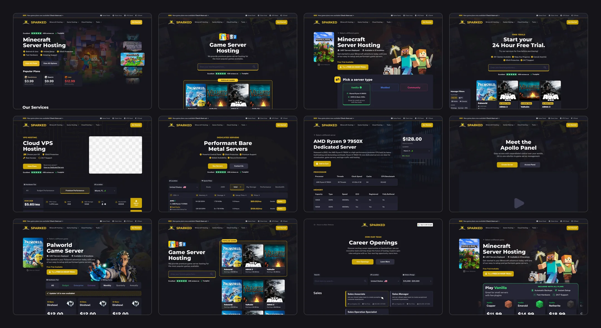
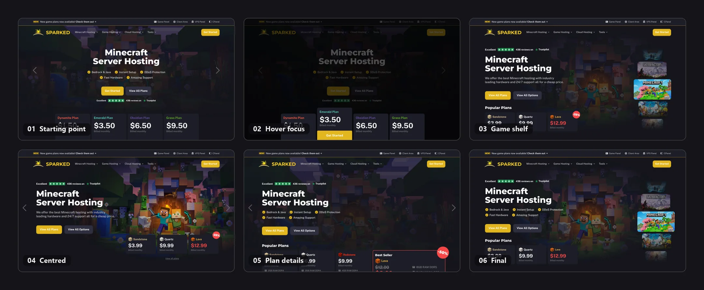
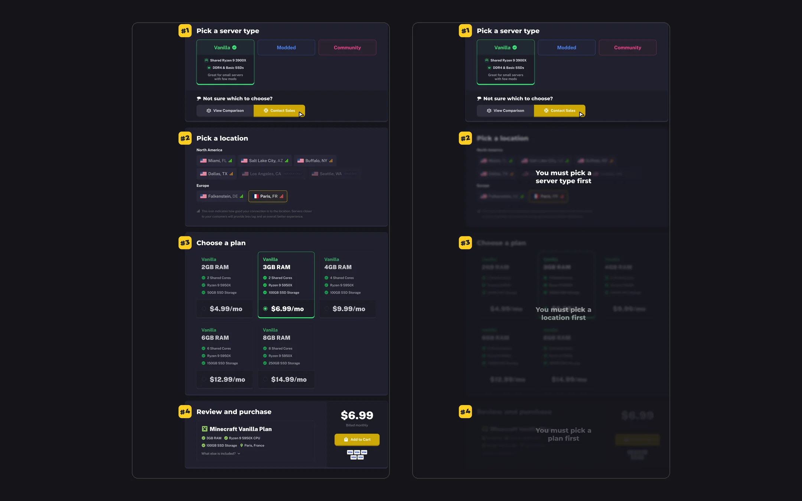
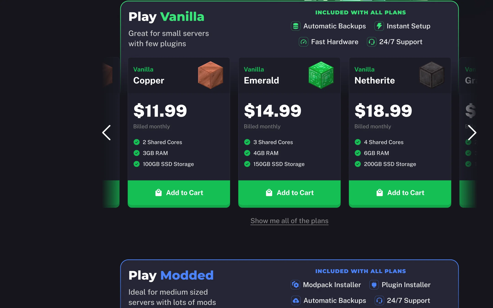
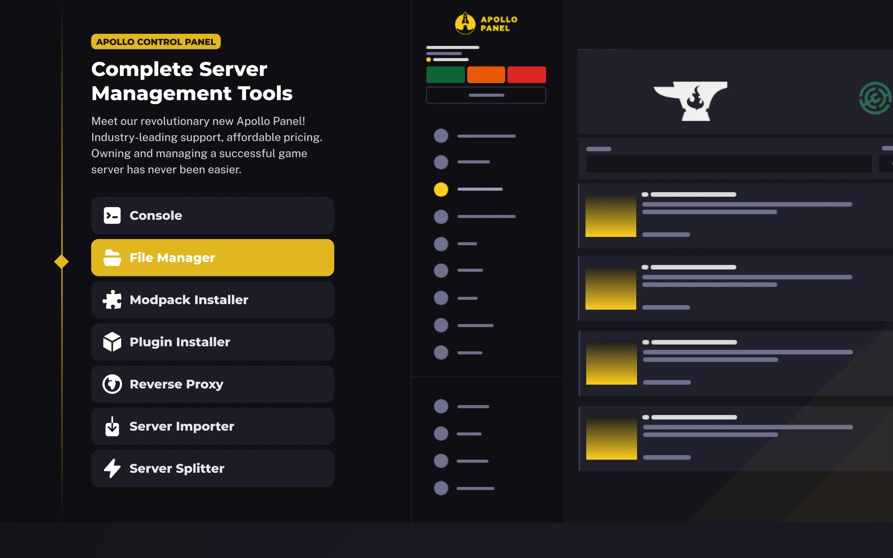
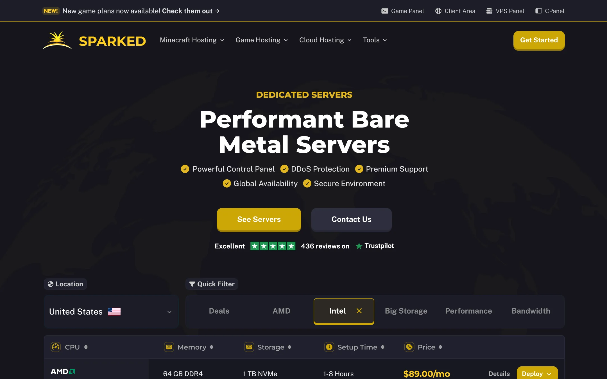
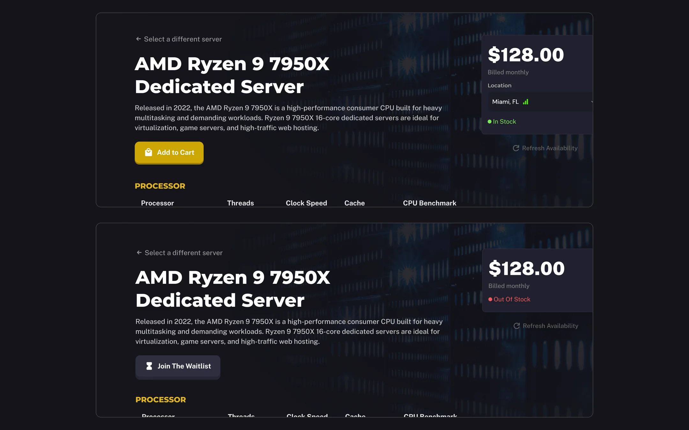

## A redesign with a checklist

Sparked Host runs servers for Minecraft and dozens of other games, with VPS and dedicated servers alongside. The brief for the redesign was unusually concrete: every page, the sections it needed, and a note on what would make each one stand out from the sites customers compare it against.

A few of those notes set the direction for everything else:

- The landing page hero had to show games and plans before anyone scrolls. A headline and a button were not enough.
- The control panel section could not look like Shockbyte's. That competitor was named.
- Plans needed to be sold three ways: two built around packages, one around a carousel, each letting the customer pick a location and a hardware line along with the plan, with free trials mentioned near the top.
- Dedicated servers should feel like a different product, with location picking and filters, not plan cards with bigger numbers.
- Product pages had to react to stock. An out-of-stock server switches its button from "buy" to "join the waitlist".

## The hero, six times

The first version was the safe one: centred headline, five check marks, four plan tiers underneath and carousel arrows on either side. Version two added a trick, where hovering a plan dims the rest of the hero and lifts that plan forward. It looked good on a desktop and it didn't survive. It needs a mouse, and it hides three plans to show one.

From there the hero split into two directions. One put Minecraft's characters in the middle and pushed the plans down, first with a discount badge, then with a highlighted "Best Seller" card carrying all of its specs. The other stacked Sparked's other games down the right edge, a shelf with Minecraft pulled forward and Satisfactory and Palworld behind it.

The shelf won, because it answers the brief's first note. The games are visible before anyone scrolls. The three popular plans sit directly under the headline with their prices, the Trustpilot score sits above it, and the rest of the catalogue is one click to the right.

## Four steps, two speeds

The two package-based versions share the same four numbered steps: server type, location, plan, then review and purchase. What differs is how much of it you see at once.

In the first, all four steps are open from the start. Someone who has bought a Minecraft server before can go straight to step three. In the second, each step unlocks only after the one above it, with a short message saying what to pick first. Nobody can choose a plan for a location that doesn't carry it, and nobody gets lost.

The details are shared. Picking Vanilla, Modded or Community reveals that type's hardware (a shared Ryzen 9, DDR4, basic SSDs for Vanilla) and who it suits. A "Not sure which to choose?" row offers a comparison and a sales contact without leaving the page. Locations are grouped by continent, and each one carries a small signal icon for how good the connection is likely to be from where the visitor is, with the ones Sparked doesn't offer for that type greyed out rather than hidden.

## Or skip the steps

The third version is for people who would rather compare prices than answer questions. Each server type gets a band of its own, Vanilla in green, Modded in blue, with "included with all plans" listed in the corner so the band itself explains the difference: Modded comes with a modpack installer and a plugin installer, Vanilla doesn't need them. Underneath, a carousel of plans named after Minecraft blocks, Copper, Emerald, Netherite, each with a price, three specs and an Add to Cart button.

## A panel section that isn't a screenshot

Every host has a section about its control panel, and nearly all of them are a screenshot with a paragraph. The brief ruled out copying one competitor's, and I didn't want another screenshot anyway.

This section is a list and a drawing. The list runs down the left: console, file manager, modpack installer, plugin installer, reverse proxy, server importer, server splitter. The drawing on the right is a simplified Apollo panel, and the highlighted tool in the list is the one drawn on the right. It says what the panel does with seven labels instead of a wall of features.

## Dedicated servers as a table

Someone buying bare metal wants to compare, not browse. So the dedicated page leads with a table, not cards. A location dropdown, a row of quick filters (deals, AMD, Intel, big storage, performance, bandwidth) and sortable columns for CPU, memory, storage, setup time and price. Each row has the processor brand, the specs that matter, the price, a details link and a deploy button. The hero above it keeps the same five check marks and Trustpilot line as the game pages, which is the one thing tying the two products together on purpose.

## Two states, one product page

Every dedicated server gets a product page with the full specifications: processor, memory, storage, bandwidth. Stock changes without anyone editing the page, so both states had to be designed, not just the happy one.

In stock, the price card shows the location with a signal icon, a green "In Stock" dot and an "Add to Cart" button. Out of stock, the location row disappears, the dot turns red, and the button becomes "Join The Waitlist". A small "Refresh Availability" link sits under the card in both states. Nothing else moves, so a customer coming back to the same page knows exactly what changed.

## The rest of the box

The pages above are the ones with a story. The project also covered the free trial page, VPS hosting, the Apollo panel page, About Us, Partnerships, an affiliate program, DDoS protection, a landing page for Google Ads, and a careers site with job listings, filters for location and salary range, and an application flow.

Sparked Host's current site is at [sparkedhost.com](https://sparkedhost.com).

<!-- TODO: add results when you have them, such as which pages launched, any change in sign-ups or sales, or a quote from the Sparked Host team. -->
