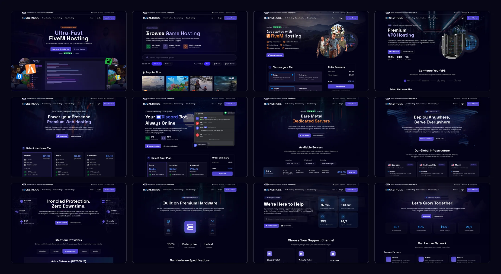
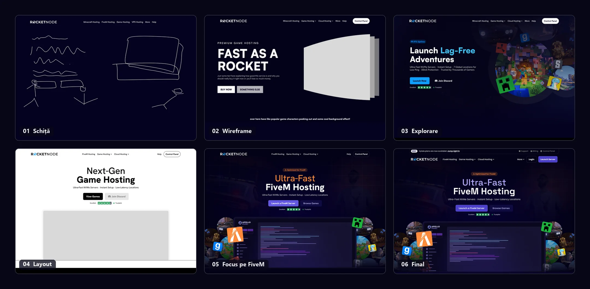
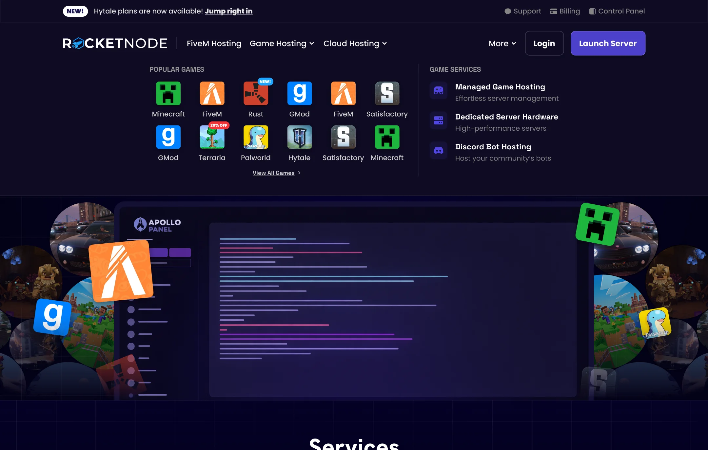
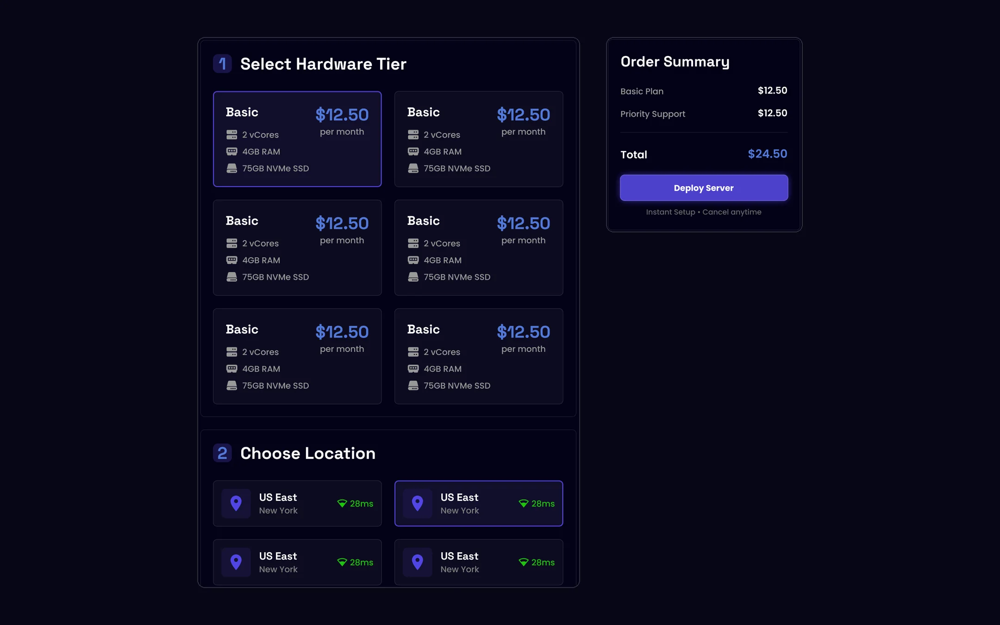
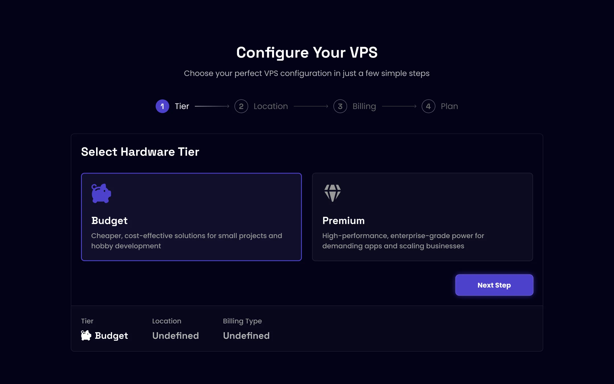
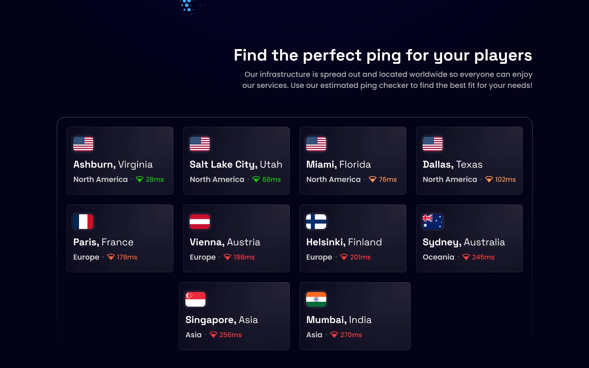
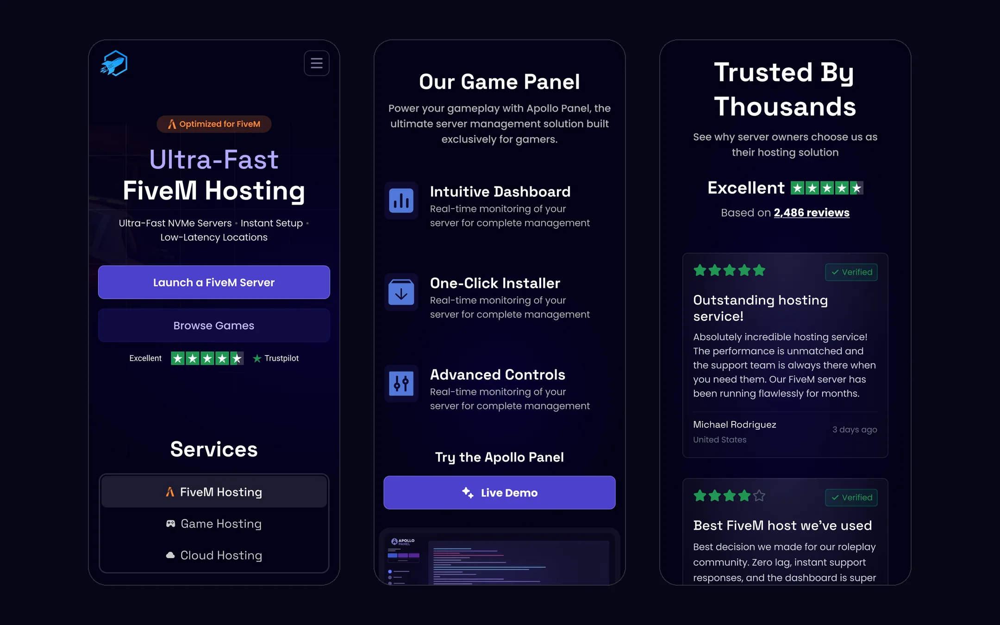

## Prezentare

RocketNode oferă hosting pentru servere de jocuri, cu FiveM (platforma multiplayer pentru GTA V) ca produs principal, alături de Minecraft, Rust și o listă lungă de alte jocuri, plus hosting VPS, web, pentru boți de Discord și servere dedicate.

Am proiectat întregul site de prezentare, de la primele schițe ale secțiunii principale până la fiecare pagină de produs, de suport și despre companie, pe desktop și pe mobil.

## Cerințele

Cerințele au venit sub forma unei liste, pagină cu pagină: o pagină principală, un catalog de jocuri, o pagină pentru fiecare joc, hosting VPS, web, pentru boți de Discord și servere dedicate, plus locații, protecție DDoS, hardware, parteneri, suport, program de afiliere, despre noi și termeni legali. Cincisprezece tipuri de pagini în total.

Câteva cerințe au modelat tot proiectul:

- **O secțiune principală cu personalitate.** În spiritul concurenților precum Iceline, dar cu o notă creativă și unică, și în niciun caz un carusel.
- **Planuri prezentate ca carduri individuale, nu într-un slider.** Clienții trebuie să vadă toate opțiunile dintr-o privire.
- **Un sistem în pași pentru configurarea unui server.** Alegi nivelul de hardware, locația, perioada de facturare și opțiuni extra, precum spațiu de stocare suplimentar sau suport prioritar.
- **Același sistem pentru VPS, dar cu alt aer.** Pași familiari, cu un aspect propriu.

## Procesul

Secțiunea principală a trecut prin cele mai multe iterații. A pornit de la o schiță rapidă și un wireframe „Fast as a Rocket”, cu un loc rezervat pentru personaje din jocuri care apar din lateral. De acolo am explorat o variantă aliniată la stânga, cu un grup de lumi din jocuri, apoi am simplificat-o într-un layout centrat, în nuanțe de gri, ca să clarific structura înainte de a adăuga culoarea.

Momentul decisiv a fost să pun chiar produsul în centru. Varianta finală arată panoul de control RocketNode, înconjurat de jocurile pe care le rulează, așa că explică dintr-o privire ce face compania. Spre final, mesajul s-a mutat de la genericul „Next-Gen Game Hosting” la FiveM, produsul principal al companiei, iar culoarea de accent s-a schimbat din portocaliu în violetul folosit pe tot site-ul.

## Navigarea

Cu zeci de jocuri și cinci produse de hosting, navigarea trebuia să acopere mult fără să pară încărcată. Meniul de jocuri începe cu iconițe ușor de recunoscut, ca oamenii să ajungă direct la jocul lor, cu mici etichete pentru jocurile noi și pentru oferte. A doua coloană cuprinde serviciile pentru jocuri. Linkurile de cont (suport, facturare și panoul de control) stau într-o bară subțire deasupra, ca să nu aglomereze meniul principal.

## Alegerea unui plan

Paginile de jocuri folosesc un configurator numerotat în locul unui slider de prețuri. Fiecare nivel de hardware apare pe un card separat, iar fiecare locație afișează un ping estimat, ca clienții să aleagă cel mai apropiat server fără să ghicească. Lângă pași stă un sumar al comenzii care ține evidența totalului, așa că prețul nu devine niciodată o surpriză la plată.

## Același sistem, alt aer

Clienții VPS aleg dintre mai puține opțiuni, dar mai mari, așa că aceeași idee capătă altă formă. O bară de progres în patru pași (nivel, locație, facturare, plan) te ghidează printr-o singură decizie odată, iar un rând de sumar din partea de jos se completează pe măsură ce faci fiecare alegere.

## Componente comune

Cincisprezece tipuri de pagini rămân coerente doar dacă folosesc aceleași piese. Am construit site-ul dintr-un singur set de secțiuni refolosite pe fiecare pagină: avantaje, locațiile centrelor de date, panoul de control, protecția DDoS, întrebări frecvente, recenzii, articole de blog și un îndemn final la acțiune. Fiecare pagină adaugă conținutul specific ei, precum planuri, hardware sau niveluri de parteneriat, iar secțiunile comune se ocupă de rest.

Grila de locații e un exemplu bun. Estimările de ping sunt colorate de la verde la roșu, așa că cele mai apropiate locații ies în evidență fără să fie nevoie să citești cifrele.

## Pe mobil

Fiecare secțiune comună are o versiune pentru mobil. Grilele late devin o singură coloană, taburile de servicii se așază unul sub altul, cardurile cu planuri se reduc la un singur plan recomandat, cu link către celelalte, iar diagrama panoului de control devine o listă simplă de funcții.

## Rezultatul

Designul este acum live pe [rocketnode.com](https://rocketnode.com).

<!-- TODO: adaugă aici rezultatele, de exemplu data lansării, schimbări în conversii sau înscrieri, ori un citat de la echipa RocketNode. -->
