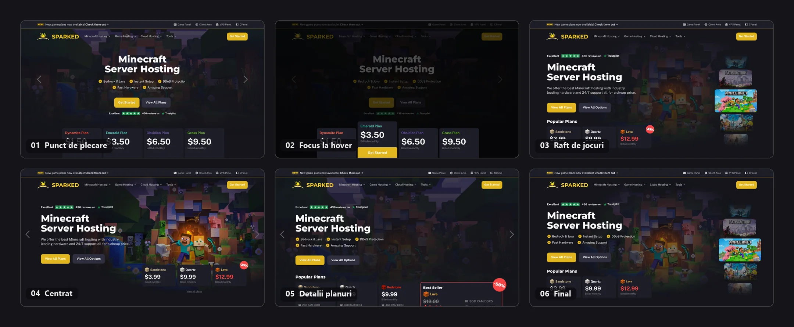

## Un redesign pagină cu pagină

Sparked Host oferă servere pentru Minecraft și zeci de alte jocuri, alături de VPS și servere dedicate. Am refăcut site-ul pagină cu pagină, stabilind pentru fiecare secțiunile de care avea nevoie și ce ar face-o să iasă în evidență față de site-urile cu care o compară clienții.

Câteva decizii au dat direcția pentru tot restul:

- Secțiunea principală a paginii de prezentare arată jocurile și planurile înainte ca cineva să deruleze. Un titlu și un buton nu erau de ajuns.
- Secțiunea despre panoul de control explică panoul, în loc să arate încă o captură de ecran.
- Planurile sunt vândute în trei moduri: două construite în jurul pachetelor, unul în jurul unui carusel, fiecare permițând alegerea locației și a liniei de hardware odată cu planul, cu perioadele de probă gratuite menționate sus în pagină.
- Serverele dedicate se simt ca un alt produs, cu alegerea locației și filtre, nu carduri de planuri cu cifre mai mari.
- Paginile de produs reacționează la stoc. Un server indisponibil își schimbă butonul din „cumpără” în „intră pe lista de așteptare”.

## Secțiunea principală, de șase ori

Prima variantă a fost cea sigură: titlu centrat, cinci bife, patru niveluri de planuri dedesubt și săgeți de carusel pe margini. A doua a adăugat un truc: când treci cu mouse-ul peste un plan, restul secțiunii se estompează și planul acela iese în față. Arăta bine pe desktop și nu a supraviețuit. Are nevoie de mouse și ascunde trei planuri ca să arate unul.

De acolo, secțiunea s-a împărțit în două direcții. Una punea personajele din Minecraft în mijloc și împingea planurile jos, întâi cu o insignă de reducere, apoi cu un card „Best Seller” evidențiat, cu toate specificațiile lui. Cealaltă așeza celelalte jocuri Sparked pe marginea din dreapta, un raft cu Minecraft tras în față și Satisfactory și Palworld în spate.

Raftul a câștigat, pentru că face singurul lucru pe care secțiunea principală trebuia să-l facă. Jocurile se văd înainte ca cineva să deruleze. Cele trei planuri populare stau direct sub titlu, cu prețurile lor, nota de pe Trustpilot stă deasupra, iar restul catalogului e la un clic distanță, în dreapta.

## Patru pași, două viteze

Cele două variante bazate pe pachete folosesc aceiași patru pași numerotați: tipul de server, locația, planul, apoi verificarea și plata. Diferența e cât vezi din ei deodată.

În prima, toți cei patru pași sunt deschiși de la început. Cine a mai cumpărat un server de Minecraft poate sări direct la pasul trei. În a doua, fiecare pas se deblochează abia după cel de deasupra, cu un mesaj scurt care spune ce trebuie ales mai întâi. Nimeni nu poate alege un plan pentru o locație care nu îl oferă, și nimeni nu se pierde.

Detaliile sunt comune. Alegerea dintre Vanilla, Modded și Community dezvăluie hardware-ul tipului respectiv (un Ryzen 9 partajat, DDR4, SSD-uri de bază pentru Vanilla) și cui i se potrivește. Un rând „Not sure which to choose?” oferă o comparație și un contact de vânzări fără să părăsești pagina. Locațiile sunt grupate pe continente și fiecare poartă o mică iconiță de semnal pentru cât de bună e probabil conexiunea de acolo de unde se află vizitatorul, iar cele pe care Sparked nu le oferă pentru tipul ales sunt estompate, nu ascunse.

## Sau sari peste pași

A treia variantă e pentru cei care preferă să compare prețuri decât să răspundă la întrebări. Fiecare tip de server primește o bandă proprie, Vanilla în verde, Modded în albastru, cu „included with all plans” listat în colț, ca banda să explice singură diferența: Modded vine cu un instalator de modpack-uri și unul de pluginuri, Vanilla nu are nevoie de ele. Dedesubt, un carusel de planuri numite după blocuri din Minecraft, Copper, Emerald, Netherite, fiecare cu un preț, trei specificații și un buton Add to Cart.

## O secțiune de panou care nu e o captură de ecran

Fiecare host are o secțiune despre panoul lui de control, și aproape toate sunt o captură de ecran cu un paragraf. Am vrut ca aceasta să explice panoul, nu doar să-l arate.

Secțiunea asta e o listă și un desen. Lista coboară pe stânga: consolă, manager de fișiere, instalator de modpack-uri, instalator de pluginuri, reverse proxy, import de server, împărțire de server. Desenul din dreapta e un panou Apollo simplificat, iar instrumentul evidențiat în listă e cel desenat în dreapta. Spune ce face panoul cu șapte etichete în loc de un zid de funcții.

## Serverele dedicate, ca tabel

Cine cumpără bare metal vrea să compare, nu să răsfoiască. Așa că pagina de servere dedicate începe cu un tabel, nu cu carduri. Un dropdown de locație, un rând de filtre rapide (oferte, AMD, Intel, stocare mare, performanță, lățime de bandă) și coloane sortabile pentru procesor, memorie, stocare, timp de configurare și preț. Fiecare rând are marca procesorului, specificațiile care contează, prețul, un link de detalii și un buton de comandă. Secțiunea principală de deasupra păstrează aceleași cinci bife și rândul cu Trustpilot ca paginile de jocuri, singurul lucru care leagă intenționat cele două produse.

## Două stări, o singură pagină de produs

Fiecare server dedicat are o pagină de produs cu specificațiile complete: procesor, memorie, stocare, lățime de bandă. Stocul se schimbă fără ca cineva să editeze pagina, așa că trebuiau proiectate ambele stări, nu doar cea fericită.

Când serverul e în stoc, cardul cu prețul arată locația cu o iconiță de semnal, un punct verde „In Stock” și un buton „Add to Cart”. Când nu mai e, rândul cu locația dispare, punctul devine roșu, iar butonul se schimbă în „Join The Waitlist”. Un mic link „Refresh Availability” stă sub card în ambele stări. Nimic altceva nu se mișcă, așa că un client care revine pe aceeași pagină știe exact ce s-a schimbat.

## Restul proiectului

Paginile de mai sus sunt cele cu o poveste. Proiectul a mai cuprins pagina perioadelor de probă gratuite, hosting-ul VPS, pagina panoului Apollo, Despre noi, Parteneriate, un program de afiliere, protecția DDoS, o pagină de destinație pentru Google Ads și un site de cariere, cu anunțuri de angajare, filtre pentru locație și interval salarial și un flux de aplicare.

Site-ul actual Sparked Host este pe [sparkedhost.com](https://sparkedhost.com).

<!-- TODO: adaugă aici rezultatele când le ai, de exemplu ce pagini s-au lansat, schimbări în înscrieri sau vânzări, ori un citat de la echipa Sparked Host. -->
