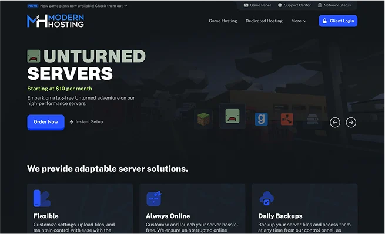
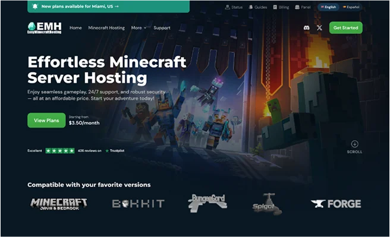
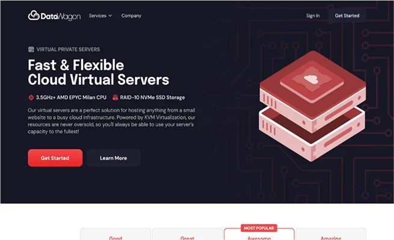

## Overview

Placeholder. Introduce the client, what they do, and why they reached out. Keep this to a short paragraph that sets the scene for the rest of the case study.

## The challenge

Placeholder. What problem needed solving? Describe the state of things before the project, the goals, and any constraints such as the timeline, brand guidelines, or technical limitations.

- Placeholder goal one
- Placeholder goal two
- Placeholder goal three

## Process

Placeholder. Walk through how you approached the work: research, wireframes, visual exploration, feedback rounds, and handoff. Screenshots of in-progress work fit well here.

## The solution

Placeholder. Show and describe the final design. Highlight the key decisions and why they work for the client's users.

## Outcome

Placeholder. Share the results: launch date, metrics, client feedback, or a quote.

> "Placeholder testimonial from the client about working together."
